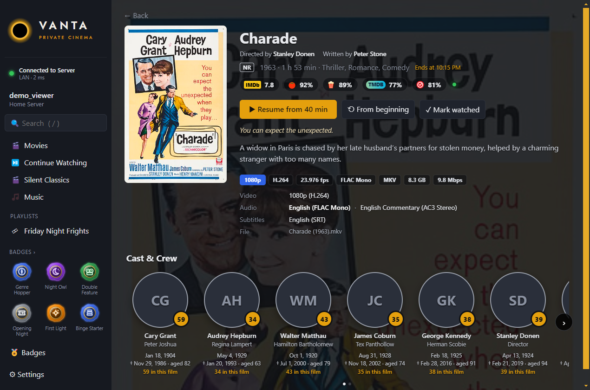
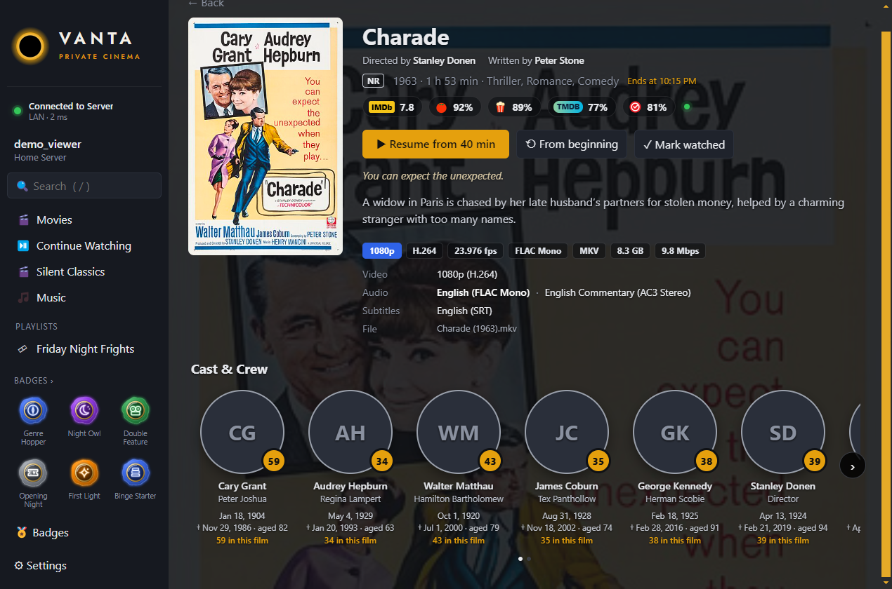
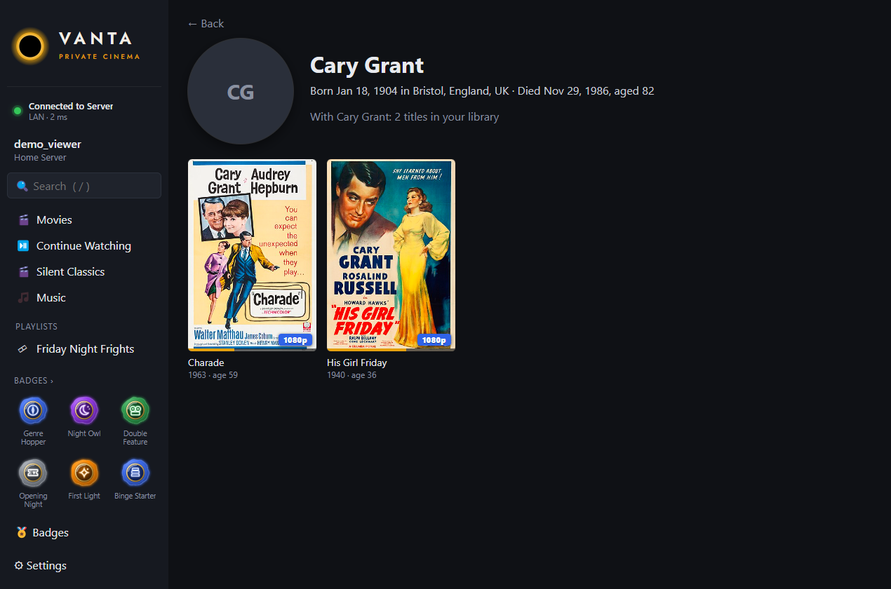
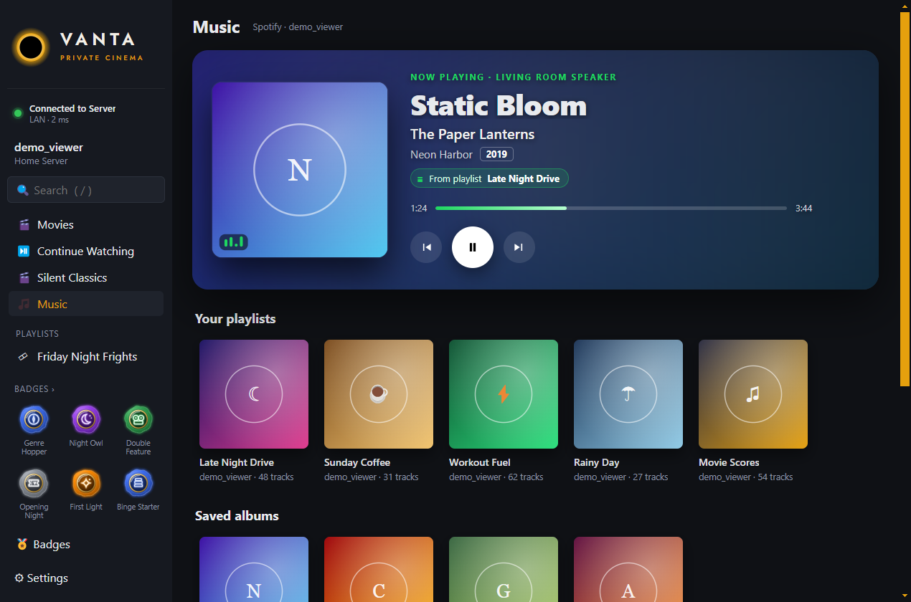
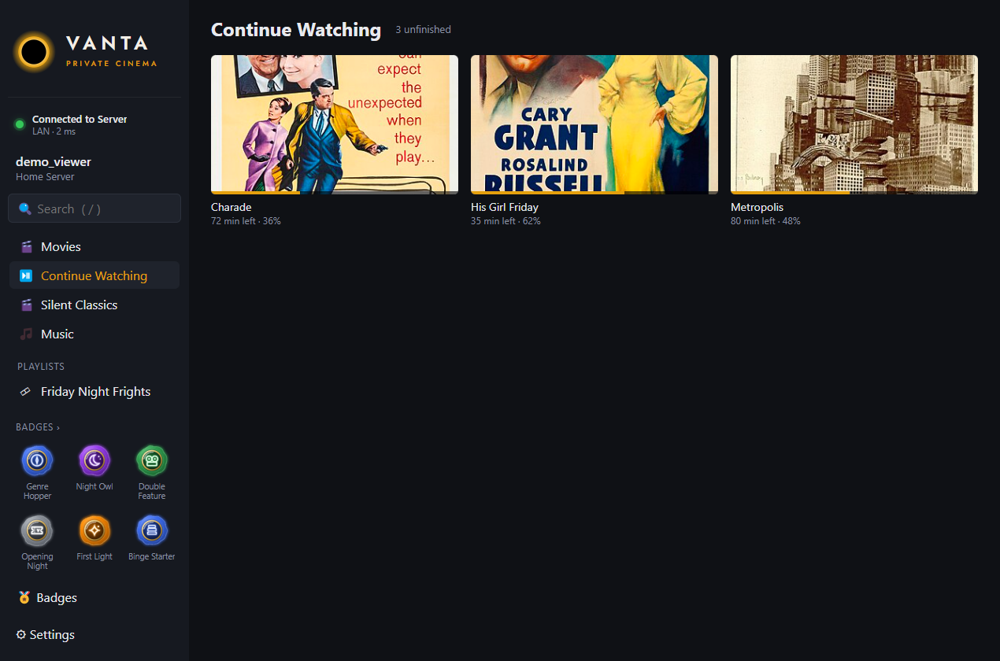
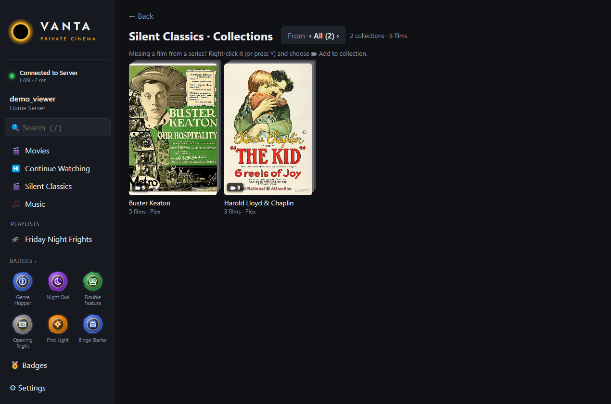
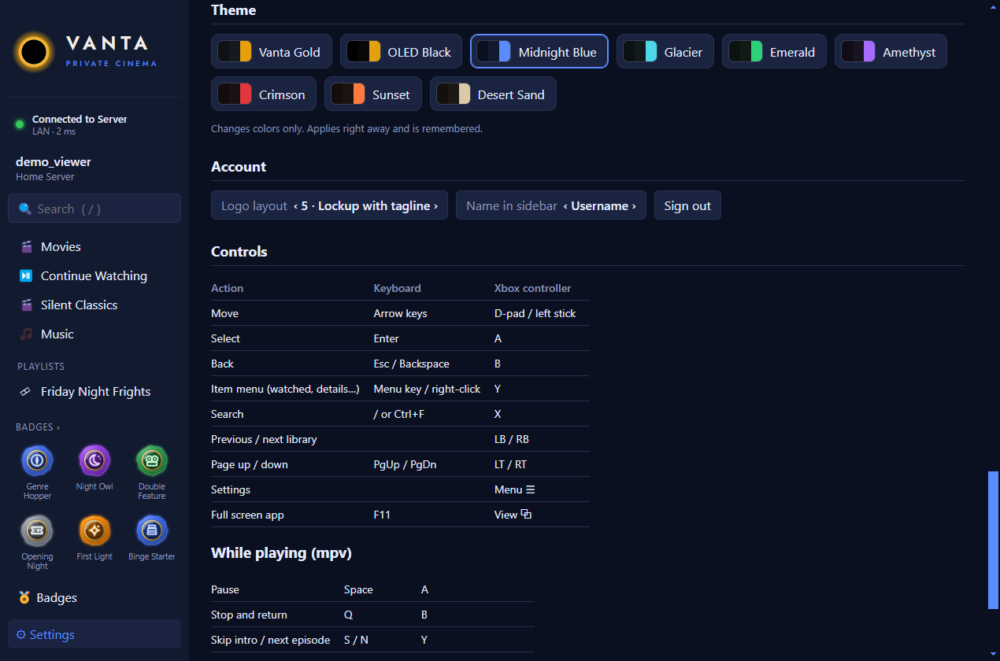
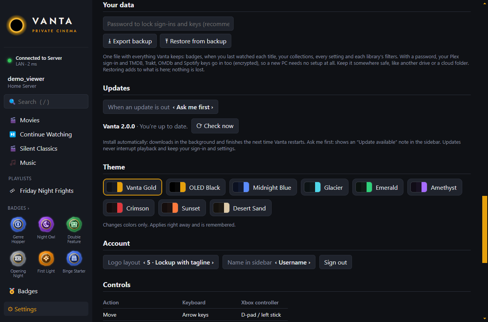

<p align="center"></p>

# Vanta: a private cinema for your Plex library


**Vanta is a media library *viewer* for [Plex](https://www.plex.tv): a quiet, fast desktop app for browsing and watching
the collection you've built yourself.** It opens straight into your movies and shows, plays everything through mpv, and
stays out of the way. And now, watching earns you something.

- **🎬 A details page that beats the big apps.** Live critic scores (IMDb, Rotten Tomatoes, Metacritic, TMDB and
  Trakt), the real data from your file (4K, HDR10 or Dolby Vision, codecs, every audio and subtitle track), the
  director and writers, and a cast row with every actor's birthday, their age today, their age in *this* film, and
  the date they passed if they're no longer with us. [More below](#details-page).
- **💬 English subtitles that find themselves.** A film with no English subtitles gets the best match for your exact
  file in the background. No account, no setup. [More below](#subtitles).
- **🔁 Trakt sync, new in 2.1.** Connect Trakt with a short code (no keys to paste) and everything you watch lands in
  your Trakt history, while one Sync now brings your whole Plex history across. [More below](#trakt).
- **🎵 Spotify, built in.** Your playlists and albums on a Music page, played on your Spotify devices, with a
  full-screen-worthy now-playing view. [More below](#music-spotify).
- **🛟 Your data is safe.** Last-watched dates, badges, collections and every setting are saved crash-safe on your PC,
  and one backup file restores a new PC with zero setup. [More below](#your-data-backup-and-restore).
- **🎨 Themes, a cover-size slider, a Continue Watching page,** your own sidebar order, and a one-click way to add a
  film TMDB missed to its series.
- **🏅 Badges.** Every film and episode you finish counts toward collectible badges in five rarities, each one announced
  with its own movie ticket. [More below](#badges).
- **🗂 Series folders.** Sequels and prequels fold into one folder poster with the first film as the cover, so a
  franchise takes one spot in your library instead of eight. [More below](#series-folders).
- **A viewer, not a manager.** Vanta doesn't scan, rename, tag or reorganise anything. Your Plex Media Server keeps doing
  that job; Vanta is the screen you watch it on. The only things it writes back are what any Plex player does: resume
  points and watched status.
- **Your library, nothing else.** No Discover, no Live TV, no streaming upsells. Just the films and shows on your own server.
- **Plays everything, untouched.** Files play directly in mpv, so 4K HDR, HEVC, lossless audio and image subtitles reach your screen as they are, with no transcoding.
- **Built for the couch.** Every screen works with the keyboard or an Xbox controller, and you sign in once.

> Release: **2.1.1**, with more cast birthdays, on top of 2.1's Trakt sync and 2.0, the biggest update yet (the new
> details page, automatic subtitles, Spotify, full backups, themes and much more). For Windows 10 and 11, with Plex Media Server on the same PC or on
> another PC in your home network.
---

## Contents
- [What's new in 2.0](#whats-new-in-20)
- [Details page](#details-page)
- [Subtitles](#subtitles)
- [Trakt](#trakt)
- [Music (Spotify)](#music-spotify)
- [Your data: backup and restore](#your-data-backup-and-restore)
- [Badges](#badges)
- [Series folders](#series-folders)
- [Made for the collection you own](#made-for-the-collection-you-own)
- [What it does](#what-it-does)
- [Screenshots](#screenshots)
- [What it leaves out](#what-it-leaves-out)
- [Requirements](#requirements)
- [Install](#install)
- [First launch](#first-launch)
- [Controls](#controls)
- [Settings](#settings)
- [Connection status](#connection-status)
- [Updates](#updates)
- [Privacy and security](#privacy-and-security)
- [Troubleshooting](#troubleshooting)
- [Uninstall](#uninstall)
- [Building from source](#building-from-source)
- [Credits and AI disclosure](#credits-and-ai-disclosure)
- [Feedback](#feedback)
- [Support Vanta](#support-vanta)

---

## What's new in 2.0

2.0 is the largest update since Vanta's first release. Everything here is free, open source, and works with the
library you already have.

| New | What it does |
|---|---|
| **Details page** | Live scores from IMDb, Rotten Tomatoes (critics and audience), Metacritic, TMDB and Trakt; real video, audio and subtitle data from your file; director, writers, tagline, rating and the time it ends if you start now. |
| **Cast & Crew with lifetimes** | Every cast member's birthday, their age today, their age in this film, and the date they died (with a quiet grey ring) if they have. Click anyone to see everything in your library they're in, with their age in each. |
| **Automatic English subtitles** | Films with no English subtitles get one in the background, best-matched to your exact file. Add your own .srt from the item menu. |
| **Music (Spotify)** | Your Spotify playlists, saved albums and recently played, played on your Spotify devices, with a large now-playing view: cover art, song, artist, album, year and the playlist it's from. |
| **Backup and restore** | One file with everything Vanta knows about you. A new PC restores from it on the sign-in screen and needs no setup at all. |
| **Crash-safe data** | Badges, last-watched dates, collections and settings are written so a crash or power cut can never leave a half-saved file, with the last good copy always kept. |
| **Last watched** | A neon-green date on every watched poster and details page, kept by Vanta even if Plex loses its history. |
| **Watched at 80%** | Stop at 80% or later and it counts as watched. Anything earlier stays in Continue Watching. |
| **Continue Watching page** | Its own sidebar page with everything you started and didn't finish, across every library, plus each show's next episode. The library pages stay clear. |
| **Add to collection** | Right-click any film, choose 🗂 Add to collection, and put it with its series (for the sequel TMDB missed) or start a new collection. The Collections page summarises them all. |
| **Themes** | Nine color themes: Vanta Gold, OLED Black, Midnight Blue, Glacier, Emerald, Amethyst, Crimson, Sunset and Desert Sand. |
| **Cover size slider** | Drag from 10 small covers per row to 2 large ones; the grid resizes as you drag and remembers your choice. |
| **Your sidebar, your order** | Move Continue Watching, each library and Music up or down in Settings → Sidebar. |
| **Bigger showcase** | Show up to nine favorite badges in the sidebar. |

---

## Details page

Open any film or episode for a page that puts everything in one place, laid directly over the film's own backdrop.

- **Scores.** IMDb, Rotten Tomatoes Tomatometer (critics) and Popcornmeter (audience), and TMDB come from your Plex
  server's metadata, and the **Trakt** score is live, all with no setup. A free OMDb key in **Settings → Scores and
  cast** makes IMDb and Rotten Tomatoes live too and adds **Metacritic**. Hover any score to see where it came from and
  how fresh it is; a green dot means live.
- **The file itself.** Tags for resolution, HDR10 / Dolby Vision / HLG, codec and bit depth, frame rate, audio format
  and channels (Atmos and DTS:X are called out), container, size and bitrate, then every audio and subtitle track.
- **People.** Directed by and Written by under the title, and a Cast & Crew row with photos, characters, birthdays,
  age today or the day they died, a gold badge with their age in this film, and a 🎂 on their birthday. Birthdays and
  deaths come from [TMDB](https://www.themoviedb.org) (the free key from Settings → Library) and are re-checked monthly.
  When TMDB has no birthday, Vanta asks [Wikidata](https://www.wikidata.org) (by the person's IMDb or Wikidata id),
  then Trakt, then [TVmaze](https://www.tvmaze.com) (only when exactly one person there has that exact name). Only
  exact dates are used, and hovering a person shows where their birthday came from.
- **Click a person** for a page of everything in your library with them, newest first, with their age in each film.

## Subtitles

English subtitles for files that have none, found and loaded for you. No account, no key, nothing to set up.

- **Exact matches first.** Vanta reads a tiny fingerprint of your file (the first and last 64 KB) and asks
  OpenSubtitles for subtitles made from that exact file, which means they're in sync.
- **Otherwise, the closest release.** Results are ranked against your file's name: resolution, source (BluRay,
  WEB-DL...), release group, codec and frame rate. Movies also check YTS-Subs.
- **In the background.** Opening a movie library queues its films; one is checked every few seconds, and anything
  without a match is tried again a week later. Anything still missing is fetched the moment you press Play.
- **Clean.** The ad lines subtitle sites insert are removed. Subtitles are kept on your PC (`%APPDATA%\vanta\subs`),
  never written to your server, and show up in the player as *English (Vanta)*.
- **Your own file.** Right-click a title → 💬 Add subtitle file to use any .srt you have.
- Turn it off in **Settings → Audio & subtitles**. If a subtitle drifts, Z and X in the player nudge it.

## Trakt

Keep your [Trakt](https://trakt.tv) history in step with what you watch in Vanta. **Settings → Trakt → Connect Trakt**
shows a short code; enter it at trakt.tv/activate and approve Vanta. That's all: no developer app, no keys to paste,
and Vanta never sees your password.

- **As you watch.** Everything Vanta marks watched (80% in the player, or Mark watched) is added to your Trakt history
  right away, and Mark unwatched removes it. Turn it off with **Send what I watch to Trakt**.
- **Sync now.** Sends every movie and episode Plex says you've watched (with Plex's own dates) that Trakt doesn't have
  yet, and copies Trakt's watch dates into Vanta's watch log. It never changes watched status in Plex.
- **Safe sign-in.** Vanta uses Trakt's device sign-in with PKCE, so there's no secret built into the app. The only
  thing kept on your PC is the sign-in Trakt hands back, encrypted with Windows' protection. **Disconnect** cancels it
  with Trakt and deletes it.
- **More than one Trakt account?** Enter the code in a private browser window, so the account you want approves Vanta.

## Music (Spotify)

The **🎵 Music** page brings your Spotify library into Vanta: your playlists, saved albums and recently played.
Click one to play it on your Spotify app, phone or speaker through Spotify Connect, and watch it in the now-playing
view with large cover art, the song, artist, album and release year, and the playlist it's playing from (only when
it is).

Setup takes two minutes, once: create a free app at [developer.spotify.com](https://developer.spotify.com/dashboard),
add the redirect URI `http://127.0.0.1:43821/callback`, tick **Web API**, and paste its Client ID into **Settings →
Music**. Then click **Connect Spotify** and approve Vanta on Spotify's own page. Vanta never sees your password.
Browsing works on any account; playing on your devices needs Spotify Premium (Spotify's rule for every app).

## Your data: backup and restore

Media collectors keep their history for years, so Vanta treats your data as precious.

- **Crash-safe by design.** Every file Vanta keeps is written to a temporary copy and swapped in only when complete,
  and the previous good version is kept beside it. If a file is ever damaged, Vanta reads the last good one.
- **Your own watch log.** Vanta keeps its own record of when you last watched each title (seeded from Plex's
  history), so the dates survive a Plex database reset, a library rebuild or a server move.
- **One file, everything.** **Settings → Your data → Export backup** saves badges and the watch sessions behind them,
  last-watched dates, your collections, every setting, each library's sort and filters, and the TMDB and cast caches.
- **Zero setup on a new PC.** Set a backup password and the file also carries your Plex, Trakt and Spotify sign-ins
  and your TMDB and OMDb keys, encrypted with AES-256 (the password is stretched with scrypt). On a fresh install, choose
  **Restore from backup** on the sign-in screen and Vanta comes back exactly as it was. Without a password, everything
  except the sign-ins and keys is saved.
- **Restoring never loses anything.** It adds to what's there: badges, dates and collections are combined, never replaced.

---

## Badges

Badges turn your own collection into something to explore. Finish films and episodes in Vanta and you earn
collectible wax-seal medallions with a neon emblem, in five rarities. **13 badges are live today.**

> **A note on badges:** development of the badge system has slowed, because I haven't had the time to give it the
> attention it deserves lately. **With your support** (see [Support Vanta](#support-vanta)), I'll come back to it
> with many more badges, seasonal drops, levels and titles. Until then its roadmap is **TBD**. The 13 badges keep working.


- **A ticket for every unlock.** It slides in at the top left with your Plex profile picture, your username and the
  reason you earned it, plus a soft chime (six sounds to choose from, or off). While Vanta is in the background, the ticket waits for you.
- **During a film, or after it.** By default, a badge you earn mid-film waits for the end of the film or the gap
  between episodes. Turn on **Settings → Badges → Show badges during playback** to see it straight away, inside the player.
- **The Badges page** (🏅 Badges, above Settings) has one row per category. Scroll a row sideways with the arrows,
  Shift + mouse wheel or a controller. Locked badges are grey silhouettes with a progress bar, and secret badges stay
  hidden until you find them.
- **Your showcase.** Star up to nine earned badges to show them in the sidebar.

| Rarity | Color | How hard |
|---|---|---|
| Common | Grey | Nearly everyone gets these |
| Uncommon | Green | Takes some steady watching |
| Rare | Blue | Dedicated viewing |
| Epic | Purple | Real commitment, and every secret badge |
| Legendary | Orange | The very few |

| Badge | Rarity | How to earn it |
|---|---|---|
| First Light | Legendary | Open Vanta for the first time. Everyone's welcome gift. |
| Opening Night | Common | Finish 5 different movies. |
| Popcorn Ready | Uncommon | Watch 1,000 minutes in total. |
| Double Feature | Uncommon | Finish 2 movies within 24 hours. |
| Triple Feature | Uncommon | Finish 3 movies within 24 hours. |
| Quadruple Feature | Uncommon | Finish 4 movies within 24 hours. |
| Six-Pack | Rare | Finish 6 movies within 24 hours. |
| Time Traveler | Uncommon | Finish a movie released from 1990 to 1999. |
| Genre Hopper | Rare | Finish movies from 5 different genres. |
| Binge Starter | Rare | Finish 3 episodes of the same show within 24 hours. |
| Season Pass | Rare | Finish every episode of a season. |
| Marathoner | Epic | Watch 48 hours of movies. |
| ??? | Epic | *Some films are best after the world goes quiet…* |

**What counts:** a title is *finished* when playback reaches its end and you actually watched at least half of it, so
skipping to the end doesn't count, and neither does rewatching the same title. "Within 24 hours" is a rolling 24 hours,
so a marathon past midnight still counts. Only watching in Vanta counts. Nothing is imported from your Plex history,
so everyone starts fresh.


---

## Series folders

A franchise takes one spot in your movie library. Every film in a series (*Alien*, *Aliens*, *Alien³*...) folds into
one folder poster: the first film's cover, with cards stacked behind it and the number of films in the corner.

- **Open a folder** to see every cover inside in release order, with **Play all** (in order) and **Shuffle**. Right-click
  a folder (or press Y) for the same.
- **Folders follow your view.** A folder sits where its first film would in the current sort. If a filter leaves only one
  film of a series, that film shows on its own.
- **Where the series come from:** your Plex collections, plus, if you add a free [TMDB](https://www.themoviedb.org) key
  in **Settings → Library**, the series The Movie Database knows about. TMDB decides what counts as a series (it keeps
  *Prometheus* apart from the *Alien* films, for example).
- **Nothing on your server changes.** Folders exist only in Vanta. No collections are created in Plex, and no files or
  folders are touched. Turn them off in **Settings → Library**.

Getting a TMDB key: create a free account at [themoviedb.org](https://www.themoviedb.org), then go to your profile's
**Settings → API**. Paste either the *API Key* or the *API Read Access Token* into Vanta.

---

## Made for the collection you own

Vanta plays what's already on **your** Plex Media Server: the films and box sets you've bought, the discs you've
backed up, your home videos and recordings. It doesn't search the web, add outside sources or download anything.
If a title isn't in your library, it isn't in Vanta.

That focus is the point. Vanta treats your collection the way a good home theatre treats a film: with care, in full
quality, and without anything competing for your attention.

---

## What it does

| Feature | Details |
|---|---|
| **Badges** | Earn collectible badges by watching, each announced with a movie ticket. A Badges page with progress on every locked badge, and a showcase of up to nine favorites. See [Badges](#badges). |
| **Series folders** | Sequels and prequels share one folder poster with the first film's cover. Open it for every film in release order, Play all or Shuffle. See [Series folders](#series-folders). |
| **Libraries at a glance** | Your movie and TV libraries in the sidebar, opening straight into a fast poster wall. Unwatched corners, episode counts and progress bars show where you are. |
| **Resolution tags** | Every poster in the library grid shows its file resolution: **4K** purple, **1080p** blue, **720p** green, lower in red. TV shows use the resolution most of their episodes have. |
| **Continue Watching** | Its own page in the sidebar: everything you started and didn't finish (under 80%), across every library, plus the next episode of each show you're following. |
| **Details page** | Live scores, the file's real video and audio data, and Cast & Crew with birthdays, ages and lifetimes. See [Details page](#details-page). |
| **Automatic subtitles** | English subtitles matched to your exact file, fetched in the background, plus your own .srt files. See [Subtitles](#subtitles). |
| **Trakt sync** | Connect with a short code; what you watch goes to your Trakt history, and Sync now brings your Plex history across. See [Trakt](#trakt). |
| **Music** | Spotify playlists and albums with a now-playing view, played on your Spotify devices. See [Music (Spotify)](#music-spotify). |
| **Last watched** | A neon-green date on watched posters and pages, kept by Vanta's own crash-safe watch log. |
| **Add to collection** | Put any film into a series folder (or a new one) from its menu; the Collections page summarises every series. |
| **Themes and layout** | Nine color themes, a live cover-size slider, and your own sidebar order. |
| **Backup and restore** | One file restores everything on a new PC, sign-in included, with no setup. See [Your data](#your-data-backup-and-restore). |
| **Sort and filter** | Sort by title, recently added, release date, rating or recently watched. Filter by genre, decade or unwatched. Your choice is remembered per library. |
| **Random pick** | "Play something I haven't seen": a suggestion that respects your current filters, with Play, Another and Details. |
| **Pinned views** | Save any sort and filter combination (for example *Horror · Unwatched*) as its own sidebar entry. |
| **Search** | Search every library at once. With a controller, press X for an on-screen keyboard. |
| **Item menu** | Right-click or press Y: play, resume, play from the beginning, details, go to show or season, mark watched or unwatched, clear progress, add to collection, add a subtitle file. |
| **Collections and playlists** | Browse your Plex collections, play them in order or shuffled, and play video playlists from the sidebar. |
| **Playback in mpv** | Direct play with resume, watched sync back to Plex (watched at 80%), auto-play of the next episode in the same window (with a countdown), and intro skip (a prompt or automatic). |
| **Controller support** | Xbox controllers work in the app and inside the player: A select, B back, Y menu, LB/RB switch library, triggers page through long lists. |
| **Connection status** | A green, yellow or red light under the logo, with a diagnostics panel that explains what's wrong. Vanta switches to a working route by itself. |
| **Sign in once** | A one-time Plex sign-in in your browser, then Vanta logs in automatically every time. |

---

## Screenshots

*All screenshots and the demo use Vanta's built-in demo mode (sample data): public-domain films with their real theatrical
posters, each marked public domain on Wikimedia Commons (see [demo/posters/CREDITS.md](demo/posters/CREDITS.md)).
Your own library shows your own cover art, straight from your Plex server.*

**The details page: scores, the file's real data, and Cast & Crew** *(sample data: scores and file details are examples)*



**Cast ages and lifetimes, and a person's page**





**Music, through Spotify** *(fictional sample artists and generated cover art)*



**Continue Watching, collections, themes and backup**









**Your movie library, with resolution tags and last-watched dates**


**Filtering by genre**


**Connection status and diagnostics**


---

## What it leaves out

On purpose: Discover and streaming services, Live TV and DVR, Watchlist, Downloads, friends and Watch Together,
Plex music libraries and photo libraries. Vanta shows your video libraries, plus Spotify on the Music page.

---

## Requirements

| What | Notes |
|---|---|
| Windows | 10 or 11, 64-bit |
| Plex Media Server | Any recent version, on this PC or another PC in your home network |
| A Plex account | The one your server is signed in to (a free account is fine) |
| mpv | **Included** in the installer. Nothing else to install. |

---

## Install

1. Download **`Vanta-Setup-2.1.1.exe`** (or newer) from the [Releases](../../releases) page.
2. Run it. Windows SmartScreen may say *"Windows protected your PC"* because the installer isn't code-signed.
   Click **More info → Run anyway**.
3. Pick an install folder (or keep the default) and finish. Vanta adds shortcuts to the **Start Menu** and the **Desktop**.

Vanta installs for your Windows user only, so it doesn't need administrator rights.

---

## First launch

1. Open **Vanta** and click **Sign in with Plex**.
2. Your browser opens Plex's own sign-in page. Sign in there and approve **Vanta**. Vanta never sees your password.
3. Switch back to Vanta. It finds your server by itself and opens your first library.

From then on Vanta signs you in automatically. To switch accounts, use **Settings → Account → Sign out**.

**Moving from another PC?** Choose **Restore from backup** on the sign-in screen instead, and pick the backup file you
exported there (see [Your data](#your-data-backup-and-restore)). With its password, you skip sign-in and setup entirely.

---

## Controls

**In the app**

| Action | Keyboard | Xbox controller |
|---|---|---|
| Move | Arrow keys | D-pad or left stick |
| Select | Enter | A |
| Back | Esc or Backspace | B |
| Item menu | Menu key or right-click | Y |
| Search | `/` or Ctrl+F | X |
| Previous / next library | | LB / RB |
| Page up / down | PgUp / PgDn | LT / RT |
| Settings | | Menu ☰ |
| Full-screen app | F11 | View ⧉ |

**While a video is playing (mpv)**

| Action | Keyboard | Xbox controller |
|---|---|---|
| Pause | Space | A |
| Stop and return to Vanta | Q | B |
| Skip intro / next episode | S / N | Y |
| Subtitles / audio track | J / # | X / D-pad up |
| Seek | ← / → | D-pad left / right (−10 s / +30 s) |
| Previous / next chapter | PgDn / PgUp | LB / RB |
| Volume | 9 / 0 | LT / RT |
| Show progress | O | D-pad down |
| Toggle full screen | F | View ⧉ |

The full list is also in **Settings → Controls**.

---

## Settings

Open **⚙ Settings** at the bottom of the sidebar (or press Menu ☰ on the controller).

| Section | Options |
|---|---|
| Playback | Start in full screen · auto-play the next episode · up-next countdown · skip intro (off, prompt, automatic) |
| Audio & subtitles | Preferred audio language · subtitles off, smart or always · subtitle language · find English subtitles automatically (on by default). *Smart* shows only forced subtitles when the audio is already in your language, and full subtitles when it isn't. |
| Video | Hardware decoding · upscaling (default, high quality, high quality + sharp) · smooth motion · your own GLSL shaders · extra mpv options |
| Badges | Show badges during playback (off by default) · unlock sound (Ember, Temple, Dusk, Hearth, Lantern, Harbor or off) with a preview · show a test ticket |
| Library | Group series into folders in movie libraries (on by default) · optional TMDB key to find series Plex hasn't grouped (it also powers cast birthdays and ages) |
| Scores and cast | Optional OMDb key for live IMDb and Rotten Tomatoes scores plus Metacritic (Trakt scores need no key) |
| Trakt | Connect Trakt (a short code at trakt.tv/activate) · Sync now · send what I watch to Trakt · Disconnect |
| Theme | Nine color themes, applied instantly |
| Music | Spotify Client ID, Connect and Disconnect |
| Your data | Export backup (with an optional password for sign-ins and keys) · Restore from backup |
| Sidebar | Show or hide each library and playlists · the order of Continue Watching, your libraries and Music · rename, reorder or remove pinned views |
| Account | Logo layout · name in the sidebar (username or full name) · sign out |

Playback changes apply the next time something starts playing.

---

## Connection status

The light under the logo shows how well Vanta can reach your server. Click it for the details.

| Light | Meaning |
|---|---|
| 🟢 **Connected to Server** | Fast, direct connection over your home network. |
| 🟡 **Connection degraded** | Vanta still works, but something is holding it back: weak Wi-Fi, slow or dropped responses, traffic going over the internet or through Plex's relay instead of your network (usually a firewall or router setting), a router whose DNS blocks Plex's secure addresses, or no internet while your server is still reachable. The second line says which. |
| 🔴 **No network / Server offline** | The cable is unplugged or Wi-Fi is off, the server PC is off or asleep, or neither the server nor the internet can be reached. |

Vanta checks every 15 seconds (every 5 seconds while red) and again when your PC wakes from sleep. If the current
route to your server stops answering, it tries every other route and switches to one that works, without a restart.

---

## Updates

Vanta updates itself from this repository's releases. You never need to come back here to download a new version.

Choose how in **Settings → Updates → When an update is out**:

| Option | What happens |
|---|---|
| **Install automatically** | The update downloads in the background and finishes the next time Vanta restarts. |
| **Ask me first** *(default)* | A gold **Update available** note appears in the sidebar. Click it to see what's new and download, then **Restart to update**. |
| **Only when I check** | No background checks. Use **Check now** in Settings whenever you like. |

- Updates are small: only the parts of Vanta that changed are downloaded.
- They install silently and keep your sign-in, settings, pins and progress.
- They never interrupt a film. Restarting to update waits until playback has stopped.
- After an update, the sidebar says **Updated** once; click it to see what's new.
- Settings → Updates always shows your current version and a **Check now** button.

> Coming from **1.0.0**? That version can't update itself yet. Install the latest version once from the [Releases](../../releases) page, and every later version arrives automatically.

---

## Privacy and security

- **Sign-in happens on Plex's own page.** Vanta receives a sign-in token, never your password.
- **The token is encrypted** with Windows' own data protection (DPAPI) and stored in `%APPDATA%\vanta\auth.bin`. Only your Windows user can decrypt it.
- **Vanta talks to three places:** plex.tv (sign-in and finding your server), your own Plex Media Server, and GitHub (to check this repository for updates, unless you choose *Only when I check*).
- **Only if you add a TMDB key:** The Movie Database, to find series and the cast's birthdays. Vanta sends it only each title's TMDB or IMDb id and TMDB person ids. Answers are cached on your PC (`tmdb-cache.json`, `credits-cache.json`, `people-cache.json`), and the key is encrypted like your sign-in (`tmdb.bin`).
- **Cast birthdays TMDB doesn't have:** Wikidata gets the person's IMDb or Wikidata id, Trakt their TMDB person id, and TVmaze their name. Nothing about you or your library is sent.
- **Trakt, for scores:** each details page asks Trakt for that title's score, sending only its IMDb id.
- **Trakt, only if you connect it:** your watch history goes to your Trakt account: the IMDb/TMDB/TVDB ids and dates of what you've watched, nothing else (no file names, no server details). The sign-in is encrypted in `trakt-auth.bin`; Disconnect deletes it.
- **OMDb, only if you add its key:** for live scores. It gets only a title's IMDb id. The key is encrypted (`omdb.bin`).
- **Only if you connect it:** Spotify, for the Music page. Sign-in happens on Spotify's own page (OAuth with PKCE, so no secret ships in Vanta); the sign-in is encrypted in `spotify.bin`.
- **Subtitles (on by default):** OpenSubtitles' public search and YTS-Subs, for files with no English subtitles. They receive the title's IMDb id or the file's fingerprint (a hash of its first and last 64 KB and its size), never the file or its name. Turn it off in Settings → Audio & subtitles.
- **Backups stay where you put them.** A backup file is written only where you choose. Sign-ins and keys go into it only if you set a password, and then only encrypted (AES-256-GCM, scrypt).
- **No telemetry, analytics or ads.** Vanta doesn't collect or send anything about you or what you watch.
- **Your data stays on your PC.** Badges (`badges.json`), last-watched dates (`watch-history.json`), your collections (`my-collections.json`) and subtitles (`subs\`) live in `%APPDATA%\vanta` and are never uploaded. Each keeps a `.bak` of its last good version. The unlock ticket shows your Plex profile picture, which Vanta loads from plex.tv.
- The settings file (`%APPDATA%\vanta\settings.json`) holds your preferences and a random device ID that Plex uses to recognise this install.

---

## Troubleshooting

| Symptom | Fix |
|---|---|
| *"Windows protected your PC"* when installing | The installer isn't code-signed. Click **More info → Run anyway**. |
| *"Signed in, but your Plex server could not be reached"* | Make sure the server PC is on and awake, and that Plex Media Server is running. Then click **Retry**. |
| The light is yellow and says *Not using LAN* or *Using Plex Relay* | Both PCs should be on the same network. Allow Plex Media Server through the server PC's firewall (TCP port 32400). |
| The light is yellow and says *DNS blocked* | Your router blocks Plex's secure addresses. Vanta keeps working over your local network. To restore the secure route, allow `plex.direct` in your router's DNS rebinding protection. |
| *"Could not start mpv"* | Reinstall Vanta. mpv lives in the install folder under `resources\mpv`. |
| A setting didn't change playback | Playback settings apply the next time a video starts. |
| Sign in with a different account | **Settings → Account → Sign out**, then sign in again. |

---

## Uninstall

1. **Windows Settings → Apps → Installed apps → Vanta → Uninstall.**
2. Optionally delete `%APPDATA%\vanta` to remove your settings, saved sign-in, badges, watch dates and subtitles. Export a backup first if you might come back.

---

## Building from source

Requirements: Windows, [Node.js](https://nodejs.org) 20 or newer, and a copy of mpv to bundle.

```bash
npm install
npm start            # build the UI and run Vanta from source
npm run demo         # run with the built-in sample library (no Plex account needed)
npm run typecheck
```

To build the installer, put `mpv.exe` (plus `d3dcompiler_43.dll` and the `mpv` folder from a
[shinchiro build](https://github.com/shinchiro/mpv-winbuild-cmake)) in `vendor/mpv`, then:

```bash
npm run dist         # writes release/Vanta-Setup-<version>.exe
```

Re-record the README media from demo mode with `node tools/demo/record.mjs` (writes `docs/demo.gif` and the
screenshots). The banner is `tools/banner/banner.html`: `node tools/banner/capture.mjs` captures its app art from demo
mode, and `design/icons/render.cjs` renders it. Badge style explorations live in `design/badge-styles`. The app icon
concepts live in `design/icons` (`node design/icons/build.mjs`).

No Plex code or copyrighted media is included in this repository. The only artwork is the demo library's public-domain posters.

---

## Credits and AI disclosure
- Made by **soybean_alien**. Licensed under the **GNU GPL v3.0** (see [LICENSE](LICENSE)).
- [Electron](https://github.com/electron/electron), [React](https://github.com/facebook/react) and [mpv](https://github.com/mpv-player/mpv). Vanta is an Electron app that plays video through mpv; the installer bundles the [shinchiro mpv build](https://github.com/shinchiro/mpv-winbuild-cmake). See [THIRD-PARTY-NOTICES](THIRD-PARTY-NOTICES.md).
- [Jost](https://github.com/indestructible-type/Jost) typeface by Indestructible Type (SIL OFL 1.1), via Fontsource.
- Plex © Plex, Inc. Vanta is an unofficial client and isn't affiliated with or endorsed by Plex, Inc.
- Series, cast and score information from [The Movie Database (TMDB)](https://www.themoviedb.org). This product uses the TMDB API but is not endorsed or certified by TMDB.
- Scores and watch-history sync with [Trakt](https://trakt.tv), optional scores from [OMDb](https://www.omdbapi.com); music from [Spotify](https://www.spotify.com) through its Web API. Vanta isn't affiliated with or endorsed by any of them.
- Subtitles found through [OpenSubtitles](https://www.opensubtitles.org) and [YTS-Subs](https://yts-subs.com), written and shared by their communities.
- **AI disclosure:** Vanta was designed with and written by **Claude Code (Anthropic, Claude Opus 5.5)**, directed and tested by the author on a real two-PC home setup (Plex Media Server on one PC, Vanta on another) before release. For 1.5, badges were tested end to end on that setup: a real episode streamed from the server and finished, and its unlock ticket appeared inside the player with the account's own profile picture. For 1.6, series folders were checked against the author's real library: 227 of its 605 films grouped into 61 series folders through TMDB, and a folder opened with its films in release order. For 2.0, the details page, cast lifetimes, automatic subtitles, Add to collection, the watch log, backup and restore, themes and the cover slider were each exercised against the author's real library on that setup; the Music page was checked with sample data only, since no Spotify account was connected during testing. For 2.1, Trakt sync was tested on the author's own Trakt account: device sign-in, a full sync of 109 watched titles, and a live add and remove of one film. For 2.1.1, the extra birthday sources were measured on 13 of the author's films: 286 of 485 cast and crew had a birthday, up from 266 with TMDB alone.

## Feedback
Your reports shape what comes next. Please open an issue and include:
- your Windows version, how Vanta connects to your server (same PC, wired, Wi-Fi) and roughly how big your library is;
- what worked, what didn't, and what the connection panel showed if it was yellow or red;
- for controller issues, which controller and how it's connected (USB, Bluetooth, wireless adapter).

**On the roadmap:** more polish across every screen, faster loading for very large libraries, and a choice between
servers when your account has more than one. Badges: **TBD** (see the note under [Badges](#badges)). Got an idea?
Open an issue and pitch it.

## Support Vanta
Vanta is free and open source, built in my spare time. If it's become your home cinema, **your support** keeps it
growing, and it's what brings the badge system back to full speed.

**A Patreon page is on the way.** The link will be right here.