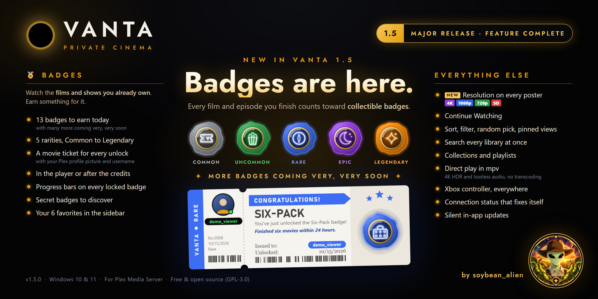
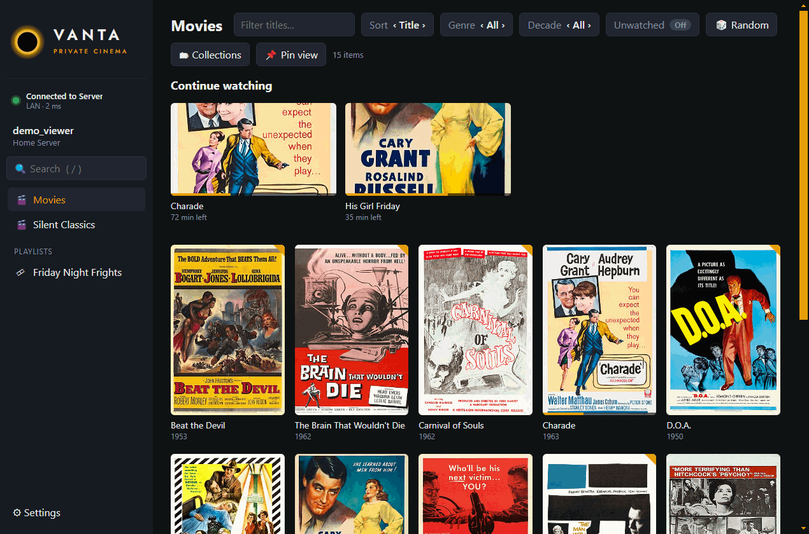
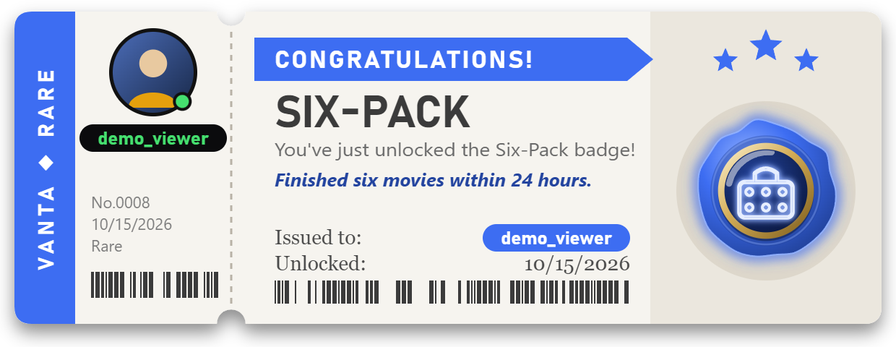
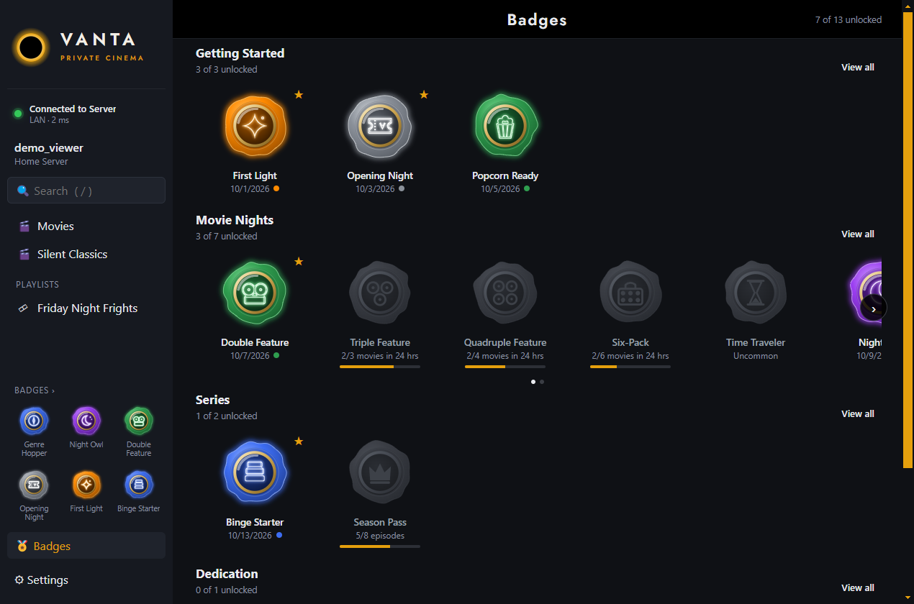
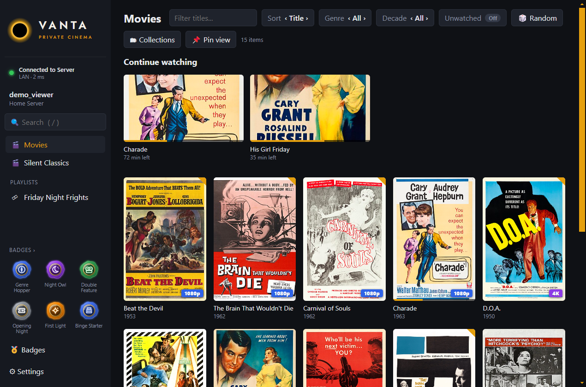
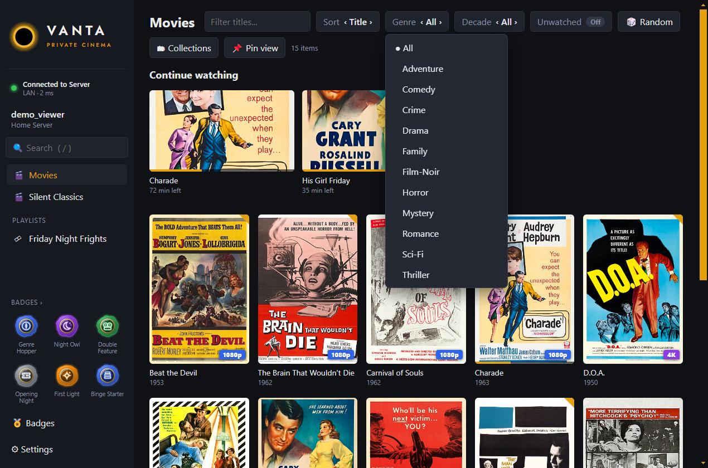
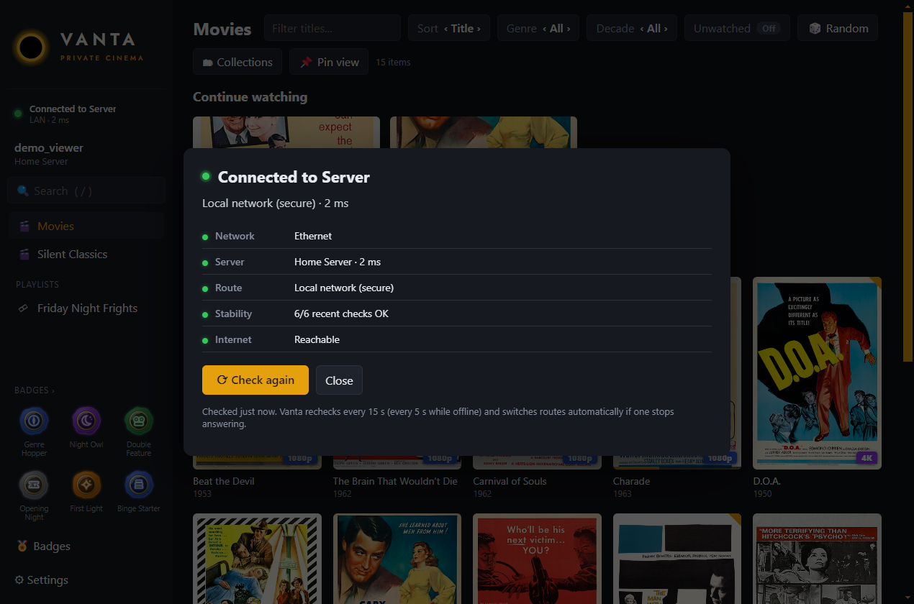

<p align="center"></p>

# Vanta: a private cinema for your Plex library



**Vanta is a media library *viewer* for [Plex](https://www.plex.tv): a quiet, fast desktop app for browsing and watching
the collection you've built yourself.** It opens straight into your movies and shows, plays everything through mpv, and
stays out of the way. And now, watching earns you something.

- **🏅 Badges.** Every film and episode you finish counts toward collectible badges in five rarities, each one announced
  with its own movie ticket. [More below](#badges).
- **A viewer, not a manager.** Vanta doesn't scan, rename, tag or reorganise anything. Your Plex Media Server keeps doing
  that job; Vanta is the screen you watch it on. The only things it writes back are what any Plex player does: resume
  points and watched status.
- **Your library, nothing else.** No Discover, no Live TV, no streaming upsells. Just the films and shows on your own server.
- **Plays everything, untouched.** Files play directly in mpv, so 4K HDR, HEVC, lossless audio and image subtitles reach your screen as they are, with no transcoding.
- **Built for the couch.** Every screen works with the keyboard or an Xbox controller, and you sign in once.

> Release: **1.5.0**, a major release and the first feature-complete version of Vanta. For Windows 10 and 11, with Plex
> Media Server on the same PC or on another PC in your home network.

---

## Contents
- [Badges](#badges)
- [Made for the collection you own](#made-for-the-collection-you-own)
- [What it does](#what-it-does)
- [Screenshots](#screenshots)
- [What it leaves out](#what-it-leaves-out)
- [Requirements](#requirements)
- [Install](#install)
- [First launch](#first-launch)
- [Controls](#controls)
- [Settings](#settings)
- [Connection status](#connection-status)
- [Updates](#updates)
- [Privacy and security](#privacy-and-security)
- [Troubleshooting](#troubleshooting)
- [Uninstall](#uninstall)
- [Building from source](#building-from-source)
- [Credits and AI disclosure](#credits-and-ai-disclosure)
- [Feedback](#feedback)

---

## Badges

Badges turn your own collection into something to explore. Finish films and episodes in Vanta and you earn
collectible wax-seal medallions with a neon emblem, in five rarities. **13 badges are live today, and more are coming
very, very soon**, including seasonal drops.



- **A ticket for every unlock.** It slides in at the top left with your Plex profile picture, your username and the
  reason you earned it, plus a soft chime (six sounds to choose from, or off). While Vanta is in the background, the ticket waits for you.
- **During a film, or after it.** By default, a badge you earn mid-film waits for the end of the film or the gap
  between episodes. Turn on **Settings → Badges → Show badges during playback** to see it straight away, inside the player.
- **The Badges page** (🏅 Badges, above Settings) has one row per category. Scroll a row sideways with the arrows,
  Shift + mouse wheel or a controller. Locked badges are grey silhouettes with a progress bar, and secret badges stay
  hidden until you find them.
- **Your showcase.** Star up to six earned badges to show them in the sidebar.

| Rarity | Color | How hard |
|---|---|---|
| Common | Grey | Nearly everyone gets these |
| Uncommon | Green | Takes some steady watching |
| Rare | Blue | Dedicated viewing |
| Epic | Purple | Real commitment, and every secret badge |
| Legendary | Orange | The very few |

| Badge | Rarity | How to earn it |
|---|---|---|
| First Light | Legendary | Open Vanta for the first time. Everyone's welcome gift. |
| Opening Night | Common | Finish 5 different movies. |
| Popcorn Ready | Uncommon | Watch 1,000 minutes in total. |
| Double Feature | Uncommon | Finish 2 movies within 24 hours. |
| Triple Feature | Uncommon | Finish 3 movies within 24 hours. |
| Quadruple Feature | Uncommon | Finish 4 movies within 24 hours. |
| Six-Pack | Rare | Finish 6 movies within 24 hours. |
| Time Traveler | Uncommon | Finish a movie released from 1990 to 1999. |
| Genre Hopper | Rare | Finish movies from 5 different genres. |
| Binge Starter | Rare | Finish 3 episodes of the same show within 24 hours. |
| Season Pass | Rare | Finish every episode of a season. |
| Marathoner | Epic | Watch 48 hours of movies. |
| ??? | Epic | *Some films are best after the world goes quiet…* |

**What counts:** a title is *finished* when playback reaches its end and you actually watched at least half of it, so
skipping to the end doesn't count, and neither does rewatching the same title. "Within 24 hours" is a rolling 24 hours,
so a marathon past midnight still counts. Only watching in Vanta counts. Nothing is imported from your Plex history,
so everyone starts fresh.



---

## Made for the collection you own

Vanta plays what's already on **your** Plex Media Server: the films and box sets you've bought, the discs you've
backed up, your home videos and recordings. It doesn't search the web, add outside sources or download anything.
If a title isn't in your library, it isn't in Vanta.

That focus is the point. Vanta treats your collection the way a good home theatre treats a film: with care, in full
quality, and without anything competing for your attention.

---

## What it does

| Feature | Details |
|---|---|
| **Badges** | Earn collectible badges by watching, each announced with a movie ticket. A Badges page with progress on every locked badge, and a showcase of your six favorites. See [Badges](#badges). |
| **Libraries at a glance** | Your movie and TV libraries in the sidebar, opening straight into a fast poster wall. Unwatched corners, episode counts and progress bars show where you are. |
| **Resolution tags** | Every poster in the library grid shows its file resolution: **4K** purple, **1080p** blue, **720p** green, lower in red. TV shows use the resolution most of their episodes have. |
| **Continue Watching** | In-progress films and the next episode of the shows you're following, at the top of each library. |
| **Sort and filter** | Sort by title, recently added, release date, rating or recently watched. Filter by genre, decade or unwatched. Your choice is remembered per library. |
| **Random pick** | "Play something I haven't seen": a suggestion that respects your current filters, with Play, Another and Details. |
| **Pinned views** | Save any sort and filter combination (for example *Horror · Unwatched*) as its own sidebar entry. |
| **Search** | Search every library at once. With a controller, press X for an on-screen keyboard. |
| **Item menu** | Right-click or press Y: play, resume, play from the beginning, details, go to show or season, mark watched or unwatched, clear progress. |
| **Collections and playlists** | Browse your Plex collections, play them in order or shuffled, and play video playlists from the sidebar. |
| **Playback in mpv** | Direct play with resume, watched sync back to Plex, auto-play of the next episode in the same window (with a countdown), and intro skip (a prompt or automatic). |
| **Controller support** | Xbox controllers work in the app and inside the player: A select, B back, Y menu, LB/RB switch library, triggers page through long lists. |
| **Connection status** | A green, yellow or red light under the logo, with a diagnostics panel that explains what's wrong. Vanta switches to a working route by itself. |
| **Sign in once** | A one-time Plex sign-in in your browser, then Vanta logs in automatically every time. |

---

## Screenshots

*All screenshots and the demo use Vanta's built-in demo mode (sample data): public-domain films with their real theatrical
posters, each marked public domain on Wikimedia Commons (see [demo/posters/CREDITS.md](demo/posters/CREDITS.md)).
Your own library shows your own cover art, straight from your Plex server.*

**Your movie library, with resolution tags and Continue Watching**



**Filtering by genre**



**Connection status and diagnostics**



---

## What it leaves out

On purpose: Discover and streaming services, Live TV and DVR, Watchlist, Downloads, friends and Watch Together,
music libraries and photo libraries. Vanta shows your video libraries and nothing else.

---

## Requirements

| What | Notes |
|---|---|
| Windows | 10 or 11, 64-bit |
| Plex Media Server | Any recent version, on this PC or another PC in your home network |
| A Plex account | The one your server is signed in to (a free account is fine) |
| mpv | **Included** in the installer. Nothing else to install. |

---

## Install

1. Download **`Vanta-Setup-1.5.0.exe`** (or newer) from the [Releases](../../releases) page.
2. Run it. Windows SmartScreen may say *"Windows protected your PC"* because the installer isn't code-signed.
   Click **More info → Run anyway**.
3. Pick an install folder (or keep the default) and finish. Vanta adds shortcuts to the **Start Menu** and the **Desktop**.

Vanta installs for your Windows user only, so it doesn't need administrator rights.

---

## First launch

1. Open **Vanta** and click **Sign in with Plex**.
2. Your browser opens Plex's own sign-in page. Sign in there and approve **Vanta**. Vanta never sees your password.
3. Switch back to Vanta. It finds your server by itself and opens your first library.

From then on Vanta signs you in automatically. To switch accounts, use **Settings → Account → Sign out**.

---

## Controls

**In the app**

| Action | Keyboard | Xbox controller |
|---|---|---|
| Move | Arrow keys | D-pad or left stick |
| Select | Enter | A |
| Back | Esc or Backspace | B |
| Item menu | Menu key or right-click | Y |
| Search | `/` or Ctrl+F | X |
| Previous / next library | | LB / RB |
| Page up / down | PgUp / PgDn | LT / RT |
| Settings | | Menu ☰ |
| Full-screen app | F11 | View ⧉ |

**While a video is playing (mpv)**

| Action | Keyboard | Xbox controller |
|---|---|---|
| Pause | Space | A |
| Stop and return to Vanta | Q | B |
| Skip intro / next episode | S / N | Y |
| Subtitles / audio track | J / # | X / D-pad up |
| Seek | ← / → | D-pad left / right (−10 s / +30 s) |
| Previous / next chapter | PgDn / PgUp | LB / RB |
| Volume | 9 / 0 | LT / RT |
| Show progress | O | D-pad down |
| Toggle full screen | F | View ⧉ |

The full list is also in **Settings → Controls**.

---

## Settings

Open **⚙ Settings** at the bottom of the sidebar (or press Menu ☰ on the controller).

| Section | Options |
|---|---|
| Playback | Start in full screen · auto-play the next episode · up-next countdown · skip intro (off, prompt, automatic) |
| Audio & subtitles | Preferred audio language · subtitles off, smart or always · subtitle language. *Smart* shows only forced subtitles when the audio is already in your language, and full subtitles when it isn't. |
| Video | Hardware decoding · upscaling (default, high quality, high quality + sharp) · smooth motion · your own GLSL shaders · extra mpv options |
| Badges | Show badges during playback (off by default) · unlock sound (Ember, Temple, Dusk, Hearth, Lantern, Harbor or off) with a preview · show a test ticket |
| Sidebar | Show or hide each library and playlists · rename, reorder or remove pinned views |
| Account | Logo layout · name in the sidebar (username or full name) · sign out |

Playback changes apply the next time something starts playing.

---

## Connection status

The light under the logo shows how well Vanta can reach your server. Click it for the details.

| Light | Meaning |
|---|---|
| 🟢 **Connected to Server** | Fast, direct connection over your home network. |
| 🟡 **Connection degraded** | Vanta still works, but something is holding it back: weak Wi-Fi, slow or dropped responses, traffic going over the internet or through Plex's relay instead of your network (usually a firewall or router setting), a router whose DNS blocks Plex's secure addresses, or no internet while your server is still reachable. The second line says which. |
| 🔴 **No network / Server offline** | The cable is unplugged or Wi-Fi is off, the server PC is off or asleep, or neither the server nor the internet can be reached. |

Vanta checks every 15 seconds (every 5 seconds while red) and again when your PC wakes from sleep. If the current
route to your server stops answering, it tries every other route and switches to one that works, without a restart.

---

## Updates

Vanta updates itself from this repository's releases. You never need to come back here to download a new version.

Choose how in **Settings → Updates → When an update is out**:

| Option | What happens |
|---|---|
| **Install automatically** | The update downloads in the background and finishes the next time Vanta restarts. |
| **Ask me first** *(default)* | A gold **Update available** note appears in the sidebar. Click it to see what's new and download, then **Restart to update**. |
| **Only when I check** | No background checks. Use **Check now** in Settings whenever you like. |

- Updates are small: only the parts of Vanta that changed are downloaded.
- They install silently and keep your sign-in, settings, pins and progress.
- They never interrupt a film. Restarting to update waits until playback has stopped.
- After an update, the sidebar says **Updated** once; click it to see what's new.
- Settings → Updates always shows your current version and a **Check now** button.

> Coming from **1.0.0**? That version can't update itself yet. Install the latest version once from the [Releases](../../releases) page, and every later version arrives automatically.

---

## Privacy and security

- **Sign-in happens on Plex's own page.** Vanta receives a sign-in token, never your password.
- **The token is encrypted** with Windows' own data protection (DPAPI) and stored in `%APPDATA%\vanta\auth.bin`. Only your Windows user can decrypt it.
- **Vanta talks to three places:** plex.tv (sign-in and finding your server), your own Plex Media Server, and GitHub (to check this repository for updates, unless you choose *Only when I check*).
- **No telemetry, analytics or ads.** Vanta doesn't collect or send anything about you or what you watch.
- **Badges stay on your PC.** Your badges and the watch history behind them live in `%APPDATA%\vanta\badges.json` and are never uploaded. The unlock ticket shows your Plex profile picture, which Vanta loads from plex.tv.
- The settings file (`%APPDATA%\vanta\settings.json`) holds your preferences and a random device ID that Plex uses to recognise this install.

---

## Troubleshooting

| Symptom | Fix |
|---|---|
| *"Windows protected your PC"* when installing | The installer isn't code-signed. Click **More info → Run anyway**. |
| *"Signed in, but your Plex server could not be reached"* | Make sure the server PC is on and awake, and that Plex Media Server is running. Then click **Retry**. |
| The light is yellow and says *Not using LAN* or *Using Plex Relay* | Both PCs should be on the same network. Allow Plex Media Server through the server PC's firewall (TCP port 32400). |
| The light is yellow and says *DNS blocked* | Your router blocks Plex's secure addresses. Vanta keeps working over your local network. To restore the secure route, allow `plex.direct` in your router's DNS rebinding protection. |
| *"Could not start mpv"* | Reinstall Vanta. mpv lives in the install folder under `resources\mpv`. |
| A setting didn't change playback | Playback settings apply the next time a video starts. |
| Sign in with a different account | **Settings → Account → Sign out**, then sign in again. |

---

## Uninstall

1. **Windows Settings → Apps → Installed apps → Vanta → Uninstall.**
2. Optionally delete `%APPDATA%\vanta` to remove your settings, saved sign-in and badges.

---

## Building from source

Requirements: Windows, [Node.js](https://nodejs.org) 20 or newer, and a copy of mpv to bundle.

```bash
npm install
npm start            # build the UI and run Vanta from source
npm run demo         # run with the built-in sample library (no Plex account needed)
npm run typecheck
```

To build the installer, put `mpv.exe` (plus `d3dcompiler_43.dll` and the `mpv` folder from a
[shinchiro build](https://github.com/shinchiro/mpv-winbuild-cmake)) in `vendor/mpv`, then:

```bash
npm run dist         # writes release/Vanta-Setup-<version>.exe
```

Re-record the README media from demo mode with `node tools/demo/record.mjs` (writes `docs/demo.gif` and the
screenshots). The banner is `tools/banner/banner.html`: `node tools/banner/capture.mjs` captures its app art from demo
mode, and `design/icons/render.cjs` renders it. Badge style explorations live in `design/badge-styles`. The app icon
concepts live in `design/icons` (`node design/icons/build.mjs`).

No Plex code or copyrighted media is included in this repository. The only artwork is the demo library's public-domain posters.

---

## Credits and AI disclosure
- Made by **soybean_alien**. Licensed under the **GNU GPL v3.0** (see [LICENSE](LICENSE)).
- [Electron](https://github.com/electron/electron), [React](https://github.com/facebook/react) and [mpv](https://github.com/mpv-player/mpv). Vanta is an Electron app that plays video through mpv; the installer bundles the [shinchiro mpv build](https://github.com/shinchiro/mpv-winbuild-cmake). See [THIRD-PARTY-NOTICES](THIRD-PARTY-NOTICES.md).
- [Jost](https://github.com/indestructible-type/Jost) typeface by Indestructible Type (SIL OFL 1.1), via Fontsource.
- Plex © Plex, Inc. Vanta is an unofficial client and isn't affiliated with or endorsed by Plex, Inc.
- **AI disclosure:** Vanta was designed with and written by **Claude Code (Anthropic, Claude Opus 5.5)**, directed and tested by the author on a real two-PC home setup (Plex Media Server on one PC, Vanta on another) before release. For 1.5, badges were tested end to end on that setup: a real episode streamed from the server and finished, and its unlock ticket appeared inside the player with the account's own profile picture.

## Feedback
Your reports shape what comes next. Please open an issue and include:
- your Windows version, how Vanta connects to your server (same PC, wired, Wi-Fi) and roughly how big your library is;
- what worked, what didn't, and what the connection panel showed if it was yellow or red;
- for controller issues, which controller and how it's connected (USB, Bluetooth, wireless adapter).

**On the roadmap:** many more badges, very soon, plus seasonal badge drops. Also more polish across every screen,
faster loading for very large libraries, and a choice between servers when your account has more than one. Got an
idea for a badge? Open an issue and pitch it.
